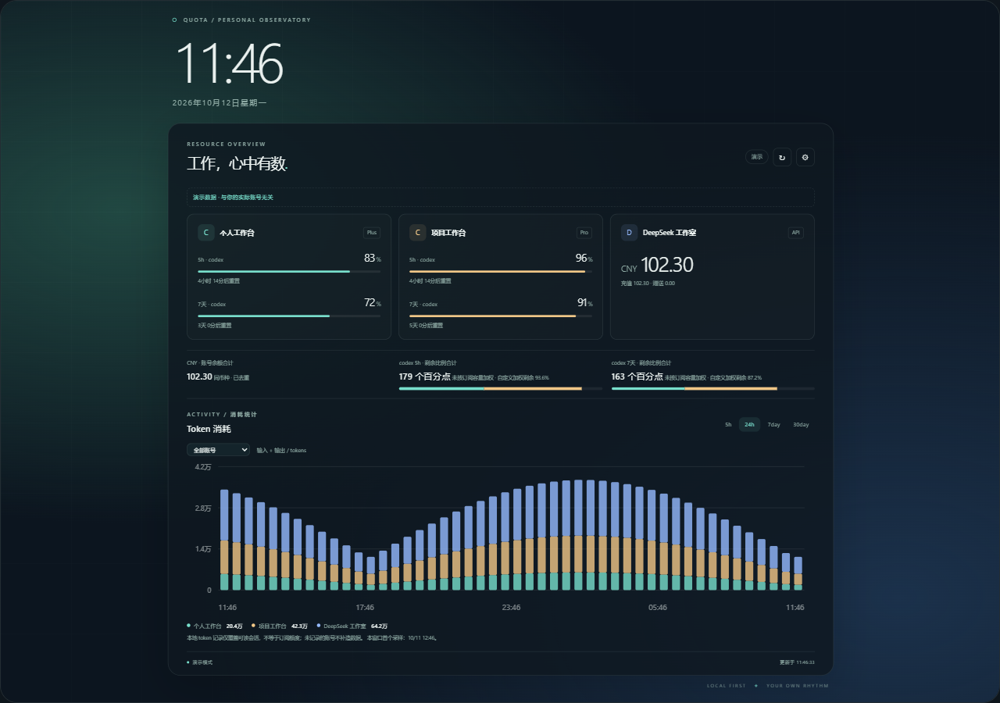

# Quota Wallpaper

可高度自定义的 **Wallpaper Engine 网页壁纸**：系统时间、Codex 订阅额度、DeepSeek 钱包与多账号消耗统计。

[下载壁纸与源码发布包](https://github.com/SweetDumplingPorridge/quota-wallpaper/releases) · [验证记录](docs/VERIFICATION.md)



## 能做什么

- 系统时间、日期、12/24 小时制、秒钟开关。
- Codex 账户实际提供的 5h、每周或其他窗口；剩余比例和独立重置倒计时。
- DeepSeek API key 查询余额；可选采集器自动读取 DSH 登录和 API key。
- 多账号、订阅标签、颜色、账号分组去重、同币种余额合计、额度分层与自定义权重。
- 过去 5h / 24h / 7day / 30day；token 输入、输出、缓存，额度变化，净余额下降支出估算；柱状与折线图。
- 横屏、竖屏、超宽屏、1080p/2K/4K 自动适配，模块、位置、大小、字体、配色、背景和透明度可调整。
- 默认低资源模式：静态背景，无持续动画，时间按分钟更新，数据默认 5 分钟更新。

## 快速使用

### 仅 Web，不安装采集器

下载发布包中的 `quota-wallpaper-web.zip`，解压。在 Wallpaper Engine 编辑器中导入 `index.html`。打开壁纸的设置按钮，选择“数据与账号 → 纯 Web”，添加 DeepSeek API key，保存账号并刷新。同账号的多个 key 填同一分组 ID。默认不记住 key，可以选择仅在本机记住。

没有实际数据时保持空状态，演示模式需要主动开启。网页不会调用模型或发送聊天，只查询余额。纯 Web 采样依赖壁纸运行；暂停和关机期间没有采样。

### 自动读取 Codex 与 DSH

需要 Node.js **20+**；建议 **24+**，以支持 DSH 压缩日志。Codex CLI 需要已安装且已登录 ChatGPT；DSH 登录或 key 在本机存在时自动读取。

```powershell
npm ci
npm run build
npm start
```

采集器默认只监听 `127.0.0.1:18765`。终端会输出带本地连接令牌的管理链接，打开后即可管理更多账号。`wallpaper/connection.json` 与 `wallpaper/live.json` 为本机生成文件，不能发布。Wallpaper Engine 请导入该 `wallpaper/index.html`。

可双击 `scripts/windows/start-collector.cmd`，也可运行 `scripts/windows/Start-Collector.ps1` 隐藏后台启动。后台 PID 记录在私有目录，使用 `Stop-Collector.ps1` 停止。

### 定时采集后退出

```powershell
npm run collect
```

运行完即退出，生成项目内的 `live.json`。壁纸可以自行读取最近一次快照。多账号配置保存在 `~/.quota-wallpaper/config.json`；可以先使用常驻模式管理账号，再换为定时模式。

`scripts/windows/Install-ScheduledCollector.ps1` 可安装每 5 分钟运行一次的用户计划任务；`Remove-ScheduledCollector.ps1` 可移除。不自动安装任务或开机服务。

### 创意工坊壁纸 + 另放的源码

订阅后壁纸路径和源码路径可能不同。让采集器写到实际壁纸项目目录：

```powershell
node collector/main.js --serve --output "D:/wallpaper-project/live.json"
```

`connection.json` 会生成在该输出目录。如果使用计划任务，安装脚本支持 `-OutputFile` 指定同一路径。创意工坊更新可能覆盖本机生成文件，重新运行采集器即可恢复。不要再次上传含这些文件的项目。

## 多账号

本地管理界面支持多个 DeepSeek key、多个独立 Codex 登录目录、多个 DSH 目录。额外 Codex 账号必须使用已经独立登录的 `CODEX_HOME`，不覆盖当前登录。普通 OpenAI API key 使用 API 计费，不能查询 Plus/Pro 的订阅额度。

DeepSeek 的不同 key 可能属于同一钱包。接口有账号身份时自动合并；没有身份时填写相同“账号分组 ID”。相同 key 会按指纹去重，不根据余额相同推断账号相同。自动 DSH 读取优先登录钱包，再回退到 API key，不把两者同时重复加入。

不同订阅的额度百分比没有统一绝对容量。总览显示“剩余比例合计（未按订阅容量加权）”，以账号颜色分层；用户设置容量权重后额外显示自定义加权比例。不同币种、额度类别、时间窗口分别汇总。

## 源码与开发

```powershell
npm ci
npm test
npm run build
npm run preview
npm run test:browser
npm run package
```

浏览器测试默认使用本机 Chrome；其他系统先运行 `npx playwright install chromium`。可设置 `CHROME_PATH` 指定浏览器、`PREVIEW_URL` 指定预览服务。预览服务默认 `127.0.0.1:18766`。

- `src/`：界面、图表、共享统计规则与纯演示数据。
- `collector/`：供应商适配器、增量日志读取、状态与本地服务。
- `wallpaper/`：Wallpaper Engine 项目、样式、打包后的 JavaScript。
- `tests/`：统计/安全/日志测试与多分辨率浏览器验证。
- `scripts/`：构建、发布、预览、Windows 启停和计划任务。

详细说明：[数据口径与隐私](docs/DATA.md)、[GitHub / 创意工坊发布](docs/PUBLISHING.md)。MIT 开源，可自行更改项目名称和版权持有人。

## 边界

余额下降是估算，不是账单。充值、赠款过期、退款等可能影响结果；窗口间长时间缺口不猜测费用。token 仅统计本地可读日志，并不等于订阅额度。缺少记录不会补造 30 天历史。接口变更、权限变化或登录失效时保留旧数据并标记不可用。供应商登录接口属于随产品版本变化的适配器。

---

**English:** A customizable, local-first Wallpaper Engine Web wallpaper for clocks, Codex subscription limits, DeepSeek wallets and multi-account charts. Web-only mode supports manually entered DeepSeek API keys. The optional Node collector discovers local Codex/DSH credentials, reads supported usage logs, and writes sanitized snapshots or serves a protected loopback endpoint. Source and release packages exclude credentials and personal histories. See the Chinese guide above for setup; all source is MIT licensed.
